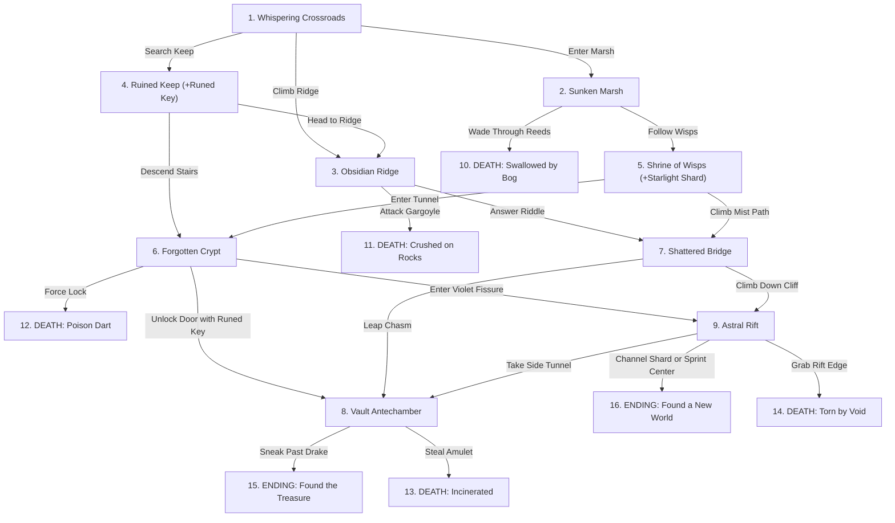

# Ashvault

Ashvault is a game you can play through a ruined fantasy world where your choices decide how the run ends. You can grab the treasure, step into a new world, or get killed.

## Team Members and Roles

| Name | Responsibility |
| --- | --- |
| Rian Atri | Story logic, inventory, state updates, and the flowchart |
| Adrian Jimenez-Molina | Layout, screens, styling, and visual design |

### Rian Atri

I handle the game state, branching logic, and the flowchart.

- I store the scenes, choices, and transitions in the story node object.
- I track the player's inventory so the Runed Key and Starlight Shard unlock extra choices.
- I wire up the click listeners that load each scene, update the top bar, and reset the run.
- I draw the 16-node flowchart and keep it matched to the code.

### Adrian Jimenez-Molina

Adrian handles the screens.

- He lays out the header, status bar, story card, choice buttons, and restart button.
- He sets the type, colors, and spacing so the text stays easy to read.
- He styles the ending badges so treasure, new world, and death screens look distinct.
- He tests every branch in the browser to make sure the buttons and states work.

## Application Overview

### The story

I start at the Whispering Crossroads on the border of a ruined kingdom with a torn map and three ways in: the Sunken Marsh, the Obsidian Ridge, and the Ruined Keep. Each route carries its own hazards. The marsh hides bottomless reeds and glowing wisps, the ridge is guarded by a stone gargoyle that asks a riddle, and the keep holds a dead knight's key and a staircase down into the dark.

The routes converge at two underground chambers: the Forgotten Crypt and the Shattered Bridge. From there, I push into either the Vault Antechamber, where an iron-scaled drake sleeps in front of the treasury, or the Astral Rift, where a tear in reality opens onto an uncharted sea.

Every run ends one of three ways:
- **Found the Treasure:** I slip past the sleeping drake into the inner vault and escape with the hoard.
- **Found a New World:** I stabilize or sprint through the Astral Rift and leave the ruins behind for a new realm.
- **Death:** Five separate traps and encounters end the run early (the bog, the gargoyle, a poisoned lock, the drake's fire, or raw rift energy).

### How a session plays

1. I open the page and land at the Whispering Crossroads with an empty inventory.
2. I read the scene description and pick one of the action buttons below the text.
3. Clicking a choice updates the screen immediately, changing the scene title, story text, location tag, and available buttons.
4. Entering the Ruined Keep adds the Runed Key to my inventory. Reaching the Shrine of the Wisps adds the Starlight Shard. Both appear in the top status bar as soon as I pick them up.
5. Later rooms check my inventory before rendering buttons. If I hold the Runed Key in the Forgotten Crypt, the option to unlock the iron door appears. If I hold the Starlight Shard at the Astral Rift, I get the option to stabilize the tear before crossing.
6. When I reach an ending, the choice buttons clear and a color-coded ending badge appears (gold for treasure, blue for new world, red for death).
7. I click Restart Journey at any point to wipe my inventory and go back to the Crossroads.

### Rules and navigation

- **Single-screen flow:** One scene renders at a time. There is no back button; once I commit to a choice, I play out that branch.
- **Persistent status bar:** The header stays visible across every scene and updates my current location and inventory in real time.
- **Automatic pickups:** I do not click to loot items. Reaching a room that holds an item adds it to my inventory array right away, and duplicate pickups are blocked.
- **Gated choices:** Choices with a `requiredItem` property stay hidden until that item is in my inventory.
- **Seven terminal nodes:** Five paths end in death, one ends with the treasure, and one ends in the new world. Not every path is the same length; a bad choice in the marsh or on the ridge can end a run in two clicks, while the full crypt route takes five.
- **Reset:** Restart Journey resets `currentNode` to `start`, empties the `inventory` array, hides any ending badge, and re-renders the opening scene.

## Story Flowchart

The flowchart has 16 nodes. Paths vary in length, meet up at key rooms, and end at one of the seven terminal nodes.

